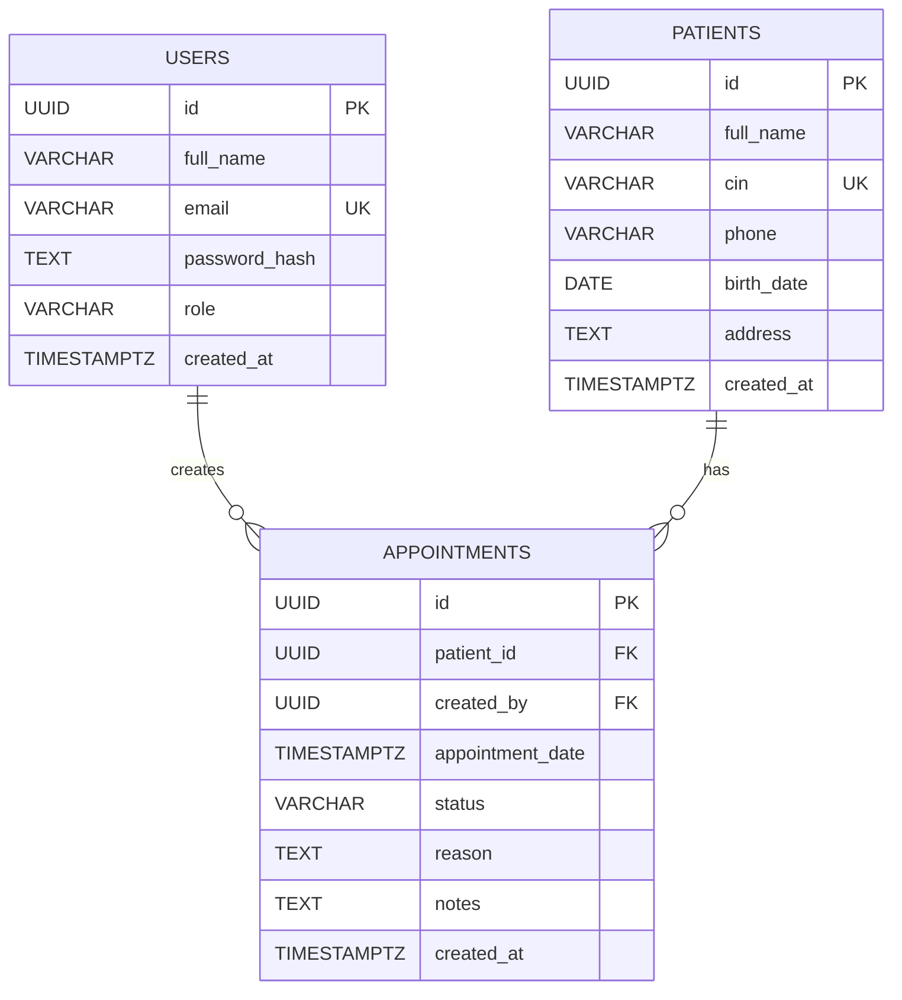

# ClinicFlow — Schéma de la base de données

## 1. Présentation

ClinicFlow utilise PostgreSQL pour gérer les utilisateurs,
les patients et leurs rendez-vous.

La base de données contient trois tables principales :
- users
- patients
- appointments

## 2. Diagramme ERD

## 3. Description des tables

### Table users

Stocke les comptes des utilisateurs de l'application.

- id : identifiant unique de type UUID (clé primaire).
- full_name : nom complet.
- email : adresse email unique.
- password_hash : mot de passe haché avec bcrypt.
- role : rôle admin ou staff.
- created_at : date de création du compte.

### Table patients

Stocke les informations des patients.

- id : identifiant unique de type UUID (clé primaire).
- full_name : nom complet du patient.
- cin : numéro CIN unique.
- phone : numéro de téléphone.
- birth_date : date de naissance.
- address : adresse facultative.
- created_at : date de création.

### Table appointments

Stocke les rendez-vous de la clinique.

- id : identifiant unique de type UUID (clé primaire).
- patient_id : référence au patient concerné.
- created_by : référence à l'utilisateur qui a créé le rendez-vous.
- appointment_date : date et heure du rendez-vous.
- status : pending, confirmed ou cancelled.
- reason : motif du rendez-vous.
- notes : notes facultatives.
- created_at : date de création.

## 4. Relations entre les tables

### Users et Appointments : relation 1-N

Un utilisateur peut créer plusieurs rendez-vous.
Chaque rendez-vous est associé à un seul utilisateur créateur.

### Patients et Appointments : relation 1-N

Un patient peut avoir plusieurs rendez-vous.
Chaque rendez-vous concerne un seul patient.

### Relation N-N

Aucune relation N-N n'est nécessaire pour les
fonctionnalités demandées dans ce projet.

## 5. Contraintes d'intégrité

- Toutes les tables possèdent une clé primaire UUID.
- L'email des utilisateurs est unique.
- Le CIN des patients est unique.
- Le rôle est limité à admin ou staff.
- Le statut est limité à pending, confirmed ou cancelled.
- Les clés étrangères garantissent l'existence des références.
- Les mots de passe sont stockés sous forme de hash bcrypt.

## 6. Règle métier

Un patient ne peut pas avoir deux rendez-vous confirmés
dont les horaires sont espacés de moins de 30 minutes.

Cette règle sera vérifiée par le backend, y compris lors
du passage d'un rendez-vous à l'état confirmed.

## 7. Index et performance

Des index seront ajoutés pour améliorer :
- La recherche des patients par nom.
- La recherche des patients par CIN.
- Le filtrage des rendez-vous par date.
- Le filtrage des rendez-vous par statut.

## 8. Suppression des données

Les règles de suppression seront définies dans le script SQL.
L'historique des rendez-vous doit être préservé.

Les clés étrangères des rendez-vous utiliseront
ON DELETE RESTRICT pour empêcher la suppression
d'un patient ou d'un utilisateur encore référencé.
